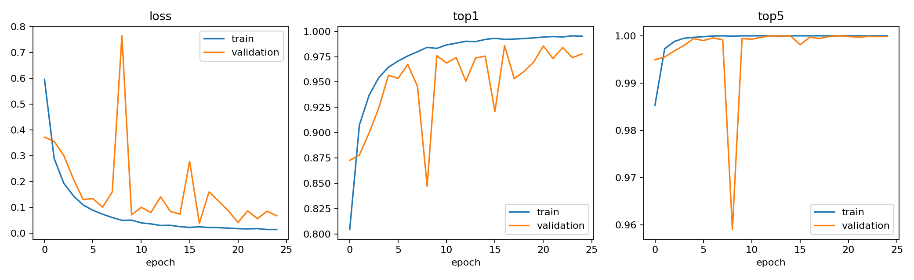
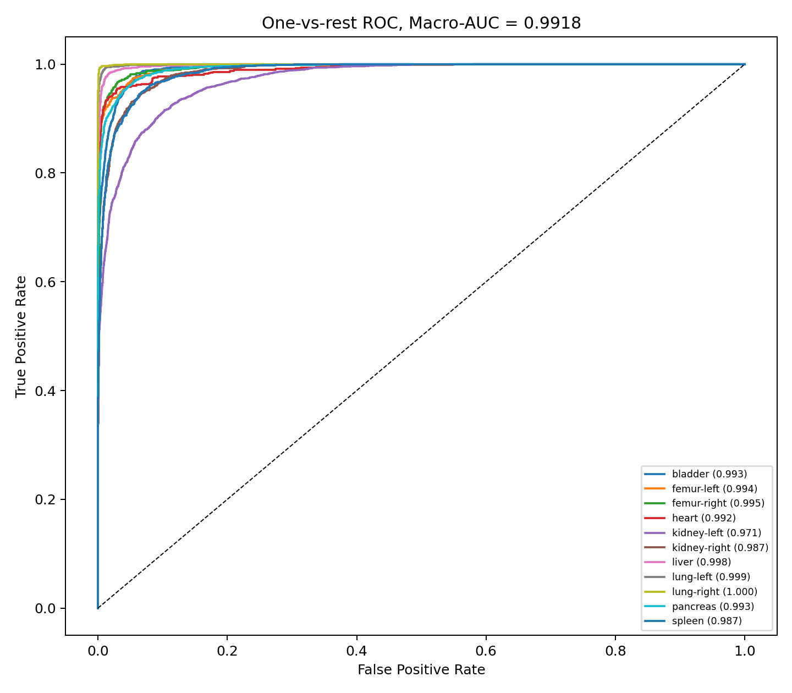
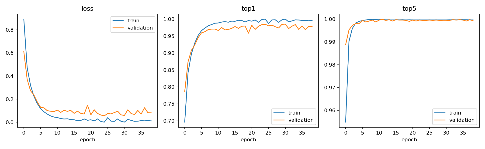
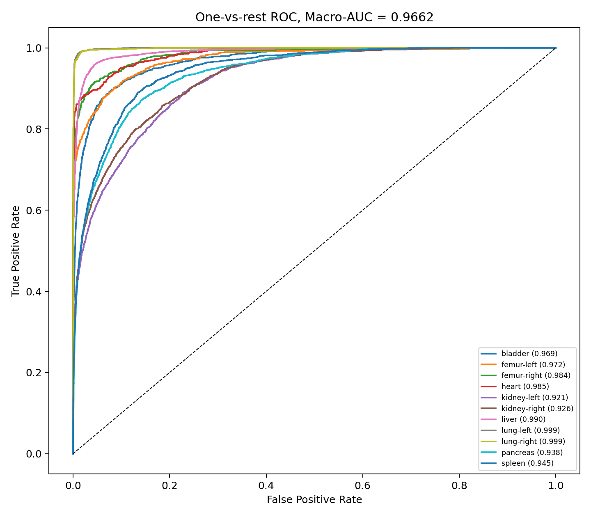
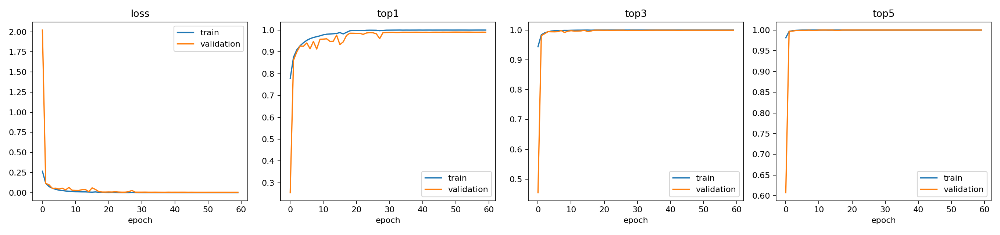
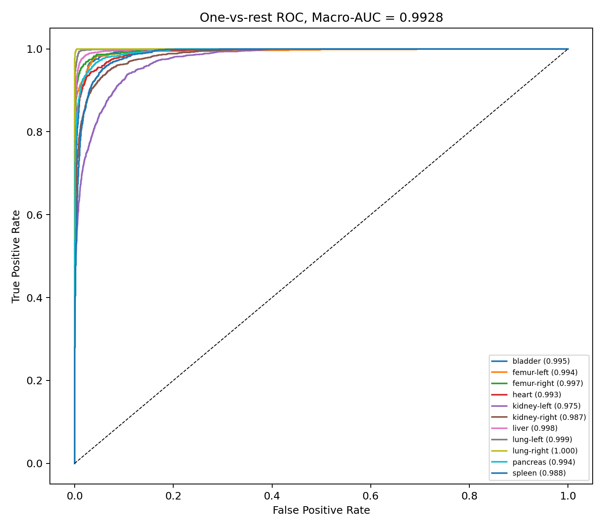
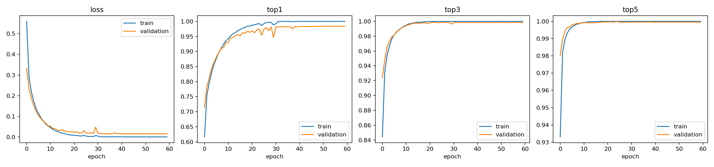
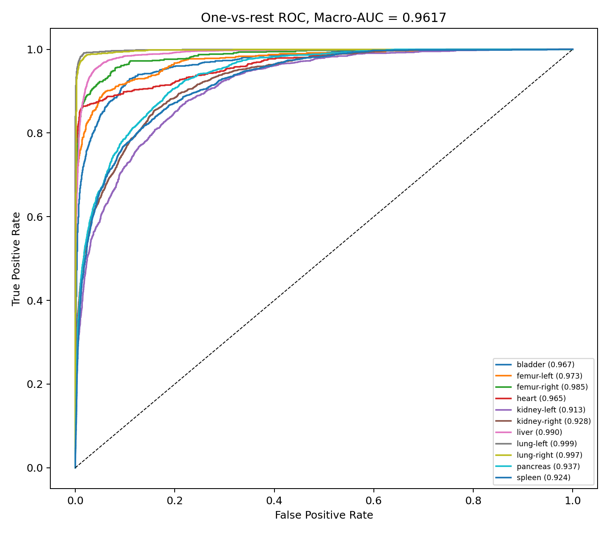
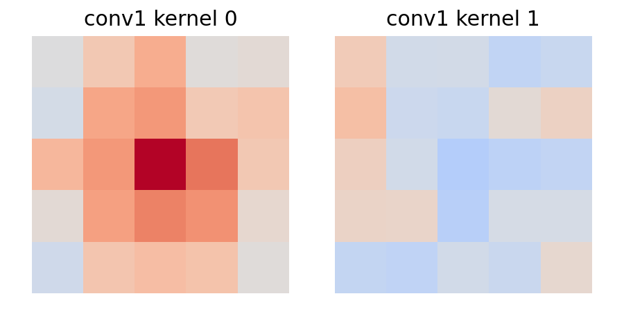

## Q1
資料集：MedMNIST的 OrganAMNIST，影像為28×28腹部CT的橫切面，共11類器官
0 :bladder 膀胱
1 :femur-left 左股骨
2 :femur-right 右股骨
3 :heart 心臟
4 :kidney-left 左腎
5 :kidney-right 右腎
6 :liver 肝臟
7 :lung-left 左肺
8 :lung-right 右肺
9 :pancreas 胰臟
10 :spleen 脾臟
使用官方分好的train、test data，分別為34,561與17,778張影像，從train中以 stratified split 按類別比例切成 80% 訓練集與 20% 驗證集。
## Q2
分別使自己創的CNN以及LeNet-5 ，自己創的CNN是參考之前自己在MNIST的模型架構，主要想法為原始輸入圖已經很小了所以用不填充來縮小特徵圖，而選LeNet-5是因為他原本設計的輸入是28 * 28接近這次選擇的資料集。
Plain CNN參數為103,659
LeNet-5參數為61,791
以及把LOSS從Cross Entropy換到Focal Loss並且Gamma為4，Learning rate從0.001到0.0005 但Batch size從32到64去彌補LR變小，訓練的epochs也從40到60增加最大訓練次數
| 模型 | Loss | Test Top-1 | Top-3 | Top-5 | Macro-AUC |
|---|---|---:|---:|---:|---:|
| Plain CNN | Cross Entropy | 88.65% | 97.53% | 99.32% | 0.9918 |
| Plain CNN `_2` | Focal γ=4 | **89.49%** | **98.01%** | **99.45%** | **0.9928** |
| LeNet-5 | Cross Entropy | **77.65%** | 92.20% | 97.20% | **0.9662** |
| LeNet-5 `_2` | Focal γ=4 | 76.56% | **92.49%** | **97.76%** | 0.9617 |
結果來看以Plain CNN改Focal Loss後體的TOP1 TOP3 TOP5的正確率都提高了Macro-AUC也提高了
從LeNet也差不多雖然TOP1 和Macro-AUC是下降的，但TOP3 TOP5是上升的
代表說我加入Focal Loss並且Gamma為4是有幫助的，能夠處裡困難樣本

## Q3
| 模型 | Test Top-1 | Test Top-3 | Test Top-5 | Macro-AUC |
|---|---:|---:|---:|---:|
| Plain CNN CNN | **88.65%** | **97.53%** | **99.32%** | **0.9918** |
| LeNet-5 | 77.65% | 92.20% | 97.20% | 0.9662 |
| Plain CNN CNN＋擴增 | 83.04% | 95.80% | 98.74% | 0.9828 |
| LeNet-5＋擴增 | 73.82% | 90.75% | 96.54% | 0.9556 |
資料擴增做了平移、小幅選轉(+-10%)以及水平翻轉
(1 :femur-left 左股骨
2 :femur-right 右股骨
4 :kidney-left 左腎
5 :kidney-right 右腎
7 :lung-left 左肺
8 :lung-right 右肺 這些有方向性的就不做水平翻轉)
做這些的目的是模擬病人拍攝時因姿勢造成的差異和移動，也避免模型學習太多對位置和角度的特徵，而水平翻轉我只用在沒有左方向問題的器官避免訓練時的標籤有錯誤

Kernel 0看起來很集中 目前猜測她是對亮度很高很集中的區域敏感的特徵
Kernel 1看起來像邊緣綠波對垂直方向的邊緣敏感
而從Grad-CAM來看模型較多關注邊邊的區域。從spleen脾臟被分類成liver肝臟，以及liver肝臟被分成kidney-right右腎的特徵圖來看，都是在關注邊緣對比度高的區域，比較沒在關注器官本生的區域。

