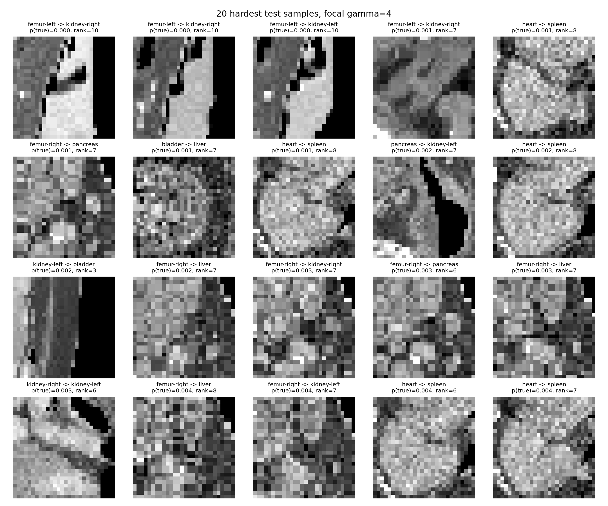
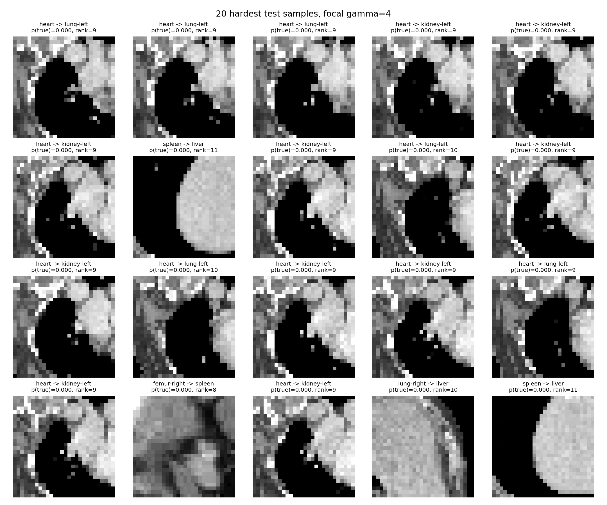

# Q2：Cross Entropy 與 Focal Loss（gamma=4）比較

## 整體結果

| 模型 | Loss | Test Top-1 | Test Top-3 | Test Top-5 | Macro-AUC |
|---|---|---:|---:|---:|---:|
| Plain CNN | Cross Entropy | 88.65% | 97.53% | 99.32% | 0.9918 |
| Plain CNN | Focal Loss | **89.49%** | **98.01%** | **99.45%** | **0.9928** |
| LeNet-5 | Cross Entropy | **77.65%** | 92.20% | 97.20% | **0.9662** |
| LeNet-5 | Focal Loss | 76.56% | **92.49%** | **97.76%** | 0.9617 |

Plain CNN 使用 Focal Loss 後，Top-1 增加 0.84 個百分點、Top-3 增加 0.48 個百分點、Macro-AUC 增加 0.0010。它修正原模型的 731 張錯誤影像，同時使原本正確的 582 張變成錯誤，淨增加 149 張正確預測。

LeNet-5 使用 Focal Loss 後，Top-1 下降 1.09 個百分點、Macro-AUC 下降 0.0045，但 Top-3 增加 0.28 個百分點、Top-5 增加 0.56 個百分點。它修正 1,065 張舊錯誤，但破壞 1,259 張舊正確，淨減少 194 張正確預測。這表示正確類別更常進入候選集合，但第一名排序變差。

## 各類別變化

Plain CNN 的主要改善為 kidney-right（Recall +4.73 個百分點）、heart（+3.06）、femur-right（+2.65）與 lung-left（+1.32）。bladder（-1.54）、spleen（-0.80）及 liver（-0.76）略為下降。最大 AUC 改善是 kidney-left，由 0.9714 增至 0.9747。

LeNet-5 僅 kidney-right（Recall +0.15）與 liver（+0.46）略有提升。bladder（-3.86）、lung-right（-3.20）、pancreas（-2.84）、lung-left（-1.55）與 heart（-1.53）均下降。heart AUC 從 0.9853 降至 0.9654，spleen 從 0.9454 降至 0.9244。

## 困難樣本

兩個 Focal Loss 模型中，focal loss 最高的 100 張影像全部是錯誤預測。這是因為排序直接選出真實類別機率最低的影像；它能確認模型最不理解的案例，但不能單憑這個現象判定資料標籤錯誤。

Plain CNN 最困難 100 張中，以 heart 35 張最多，其次是 femur-left 13 張、kidney-left 13 張與 pancreas 11 張。主要錯誤包含 heart → lung-left、heart → spleen、femur-left → kidney-right，以及 pancreas → kidney-right。最困難 100 張的平均真實類別機率只有 0.00629。

LeNet-5 最困難 100 張中有 64 張是 heart，且許多外觀非常相似，主要被判成 kidney-left 或 lung-left。這些 heart 的真實類別經常只排第 9 或第 10。最困難 100 張的平均真實類別機率只有 0.0000806，顯示 LeNet-5 對這群影像是系統性失敗，而非接近決策邊界的小誤差。

## 訓練與泛化

Plain CNN 的最佳 validation Top-1 為 99.07%，official test 為 89.49%；LeNet-5 的最佳 validation Top-1 為 98.37%，official test 為 76.56%。兩者在訓練集都達到接近 100%，但 test 仍有明顯落差，所以 Focal Loss 沒有解決 train/validation 與 official test 之間的分布差異。

Plain CNN 的平均預測信心由 95.05% 降至 86.97%，10-bin ECE 由 0.0640 降至 0.0280。LeNet-5 的 ECE 也由 0.1620 降至 0.0634。因此 Focal Loss 雖然沒有讓 LeNet-5 的 Top-1 變好，卻明顯減少兩個模型的過度自信。

## 結論

gamma=4 的 Focal Loss 適合 Plain CNN，能小幅改善 Top-1、Top-3、Top-5 與 Macro-AUC，並改善預測信心校準。對 LeNet-5 而言，gamma=4 過度強調少數極端或模糊影像；受限於模型容量，容易犧牲一般樣本的第一名排序，因此不建議用它取代原本 Cross Entropy 結果。若繼續調整 LeNet-5，可把 gamma 降至 2 或 3，並保持其他超參數不變，以確認問題是否來自 gamma 過高。
