# MMIP WEEK4

## Q1 資料集
IMDb Movie Reviews 電影評論的正面、負面情緒分類。
Beans 用豆類植物葉片照片辨識健康、豆銹病、角斑病，共三類。
Flickr8k 每張影像配有 5 條由人工撰寫的描述語句，影像選自 6 個不同的 Flickr 群組，主要描繪日常活動、人物、動物（如狗奔跑、玩耍）、運動及戶外場景，不包含知名人物或特定地標。
| 用途 | 資料集 | 訓練 | 驗證 | 測試 | 類別／描述 |
| --- | --- | --- | --- | --- | --- |
| 情緒分類 | IMDb Movie Reviews | 20000 | 5000 | 25000 | negative / positive |
| 影像分類 | Beans | 1034 | 133 | 128 | angular_leaf_spot / bean_rust / healthy |
| 影像描述 | Flickr8k | 6000 | 1000 | 1000 | 每張 5 句；caption pairs 30000 / 5000 / 5000 |

## Q2 IMDb 情緒分類

| 模型 | Accuracy | Macro Precision | Macro Recall | Macro-F1 | Macro-AUC | 測試數 |
| --- | --- | --- | --- | --- | --- | --- |
| rnn | 67.30% | 0.6738 | 0.6730 | 0.6727 | 0.7387 | 25000 |
| lstm | 85.60% | 0.8562 | 0.8560 | 0.8560 | 0.9241 | 25000 |

| 模型 | 參數量 | 訓練時間 s | 平均推論 ms／筆 | 實際 epochs |
| --- | --- | --- | --- | --- |
| rnn | 2576577 | 2502.84 | 2.740 | train=6 |
| lstm | 2613633 | 203.52 | 0.719 | train=4 |

### rnn 各類別結果

| 類別 | Precision | Recall | F1 | Support |
| --- | --- | --- | --- | --- |
| negative | 0.6623 | 0.7060 | 0.6835 | 12500 |
| positive | 0.6853 | 0.6401 | 0.6619 | 12500 |
| macro avg | 0.6738 | 0.6730 | 0.6727 | 25000 |
| weighted avg | 0.6738 | 0.6730 | 0.6727 | 25000 |

混淆矩陣：列為真實類別，欄為預測類別。

| 真實／預測 | negative | positive |
| --- | --- | --- |
| negative | 8825 | 3675 |
| positive | 4499 | 8001 |

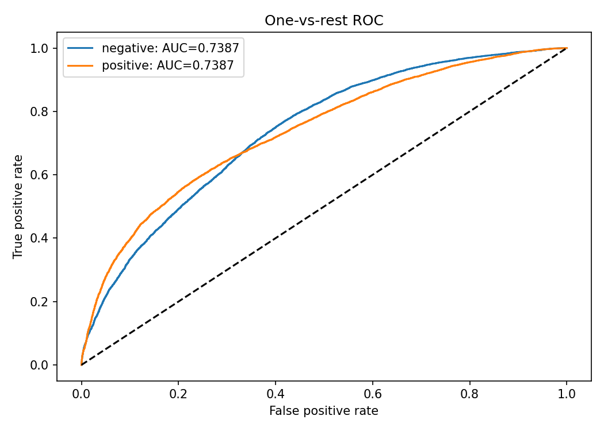

train：依 validation loss 最低選擇第 3 epoch；val_loss=0.603350，同一 epoch val_accuracy=0.665000。

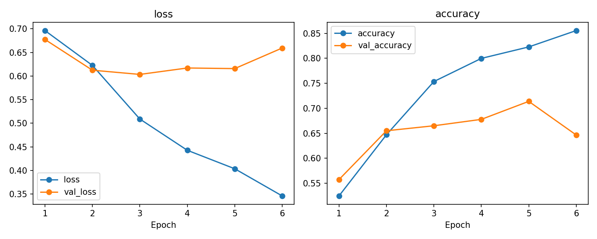

### lstm 各類別結果

| 類別 | Precision | Recall | F1 | Support |
| --- | --- | --- | --- | --- |
| negative | 0.8628 | 0.8467 | 0.8547 | 12500 |
| positive | 0.8495 | 0.8654 | 0.8574 | 12500 |
| macro avg | 0.8562 | 0.8560 | 0.8560 | 25000 |
| weighted avg | 0.8562 | 0.8560 | 0.8560 | 25000 |

混淆矩陣：列為真實類別，欄為預測類別。

| 真實／預測 | negative | positive |
| --- | --- | --- |
| negative | 10584 | 1916 |
| positive | 1683 | 10817 |

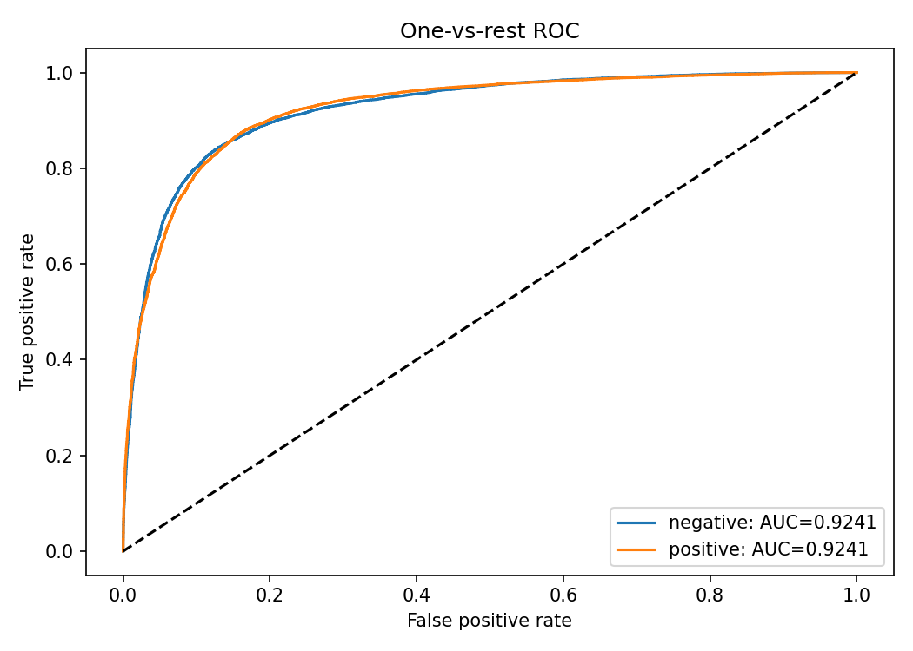

train：依 validation loss 最低選擇第 1 epoch；val_loss=0.316025，同一 epoch val_accuracy=0.871800。

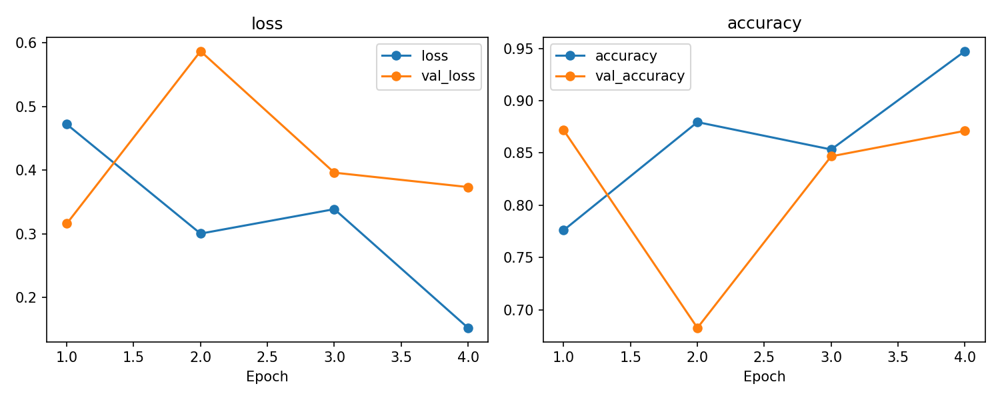

## Q3 

| 模型 | Accuracy | Macro Precision | Macro Recall | Macro-F1 | Macro-AUC | 測試數 |
| --- | --- | --- | --- | --- | --- | --- |
| q3_vit | 91.41% | 0.9145 | 0.9144 | 0.9144 | 0.9894 | 128 |
| q3_resnet | 96.88% | 0.9696 | 0.9690 | 0.9690 | 0.9957 | 128 |

| 模型 | 參數量 | 訓練時間 s | 平均推論 ms／筆 | 實際 epochs |
| --- | --- | --- | --- | --- |
| q3_vit | 85800963 | 270.78 | 31.781 | finetune=10；warmup=3 |
| q3_resnet | 23593859 | 112.59 | 13.124 | finetune=10；warmup=3 |

### vit 各類別結果

| 類別 | Precision | Recall | F1 | Support |
| --- | --- | --- | --- | --- |
| angular_leaf_spot | 0.9048 | 0.8837 | 0.8941 | 43 |
| bean_rust | 0.8864 | 0.9070 | 0.8966 | 43 |
| healthy | 0.9524 | 0.9524 | 0.9524 | 42 |
| macro avg | 0.9145 | 0.9144 | 0.9144 | 128 |
| weighted avg | 0.9142 | 0.9141 | 0.9141 | 128 |

混淆矩陣：列為真實類別，欄為預測類別。

| 真實／預測 | angular_leaf_spot | bean_rust | healthy |
| --- | --- | --- | --- |
| angular_leaf_spot | 38 | 4 | 1 |
| bean_rust | 3 | 39 | 1 |
| healthy | 1 | 1 | 40 |

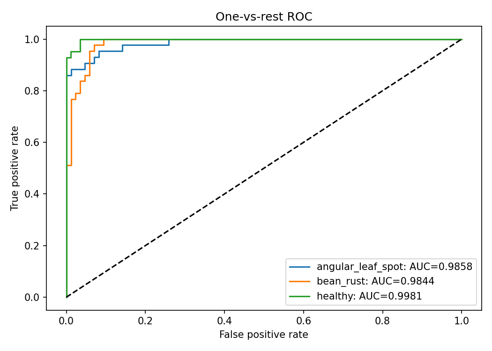

finetune：依 validation loss 最低選擇第 10 epoch；val_loss=0.063092，同一 epoch val_accuracy=0.977444。

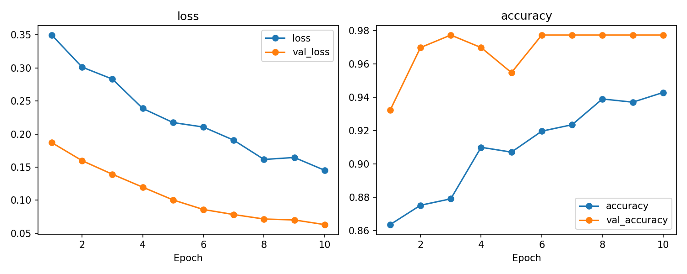

warmup：依 validation loss 最低選擇第 3 epoch；val_loss=0.215921，同一 epoch val_accuracy=0.909774。

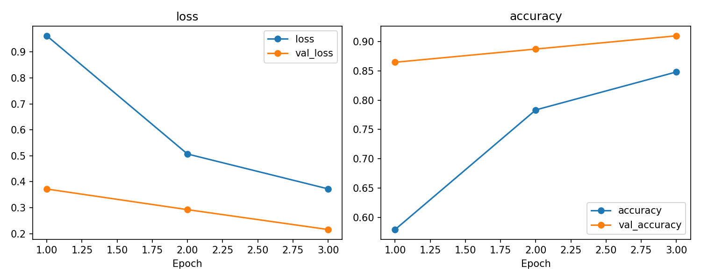

使用預訓練 backbone 並實際微調；最終採用 finetune 權重。warmup 最佳 val_loss=0.215921，finetune 最佳 val_loss=0.063092。

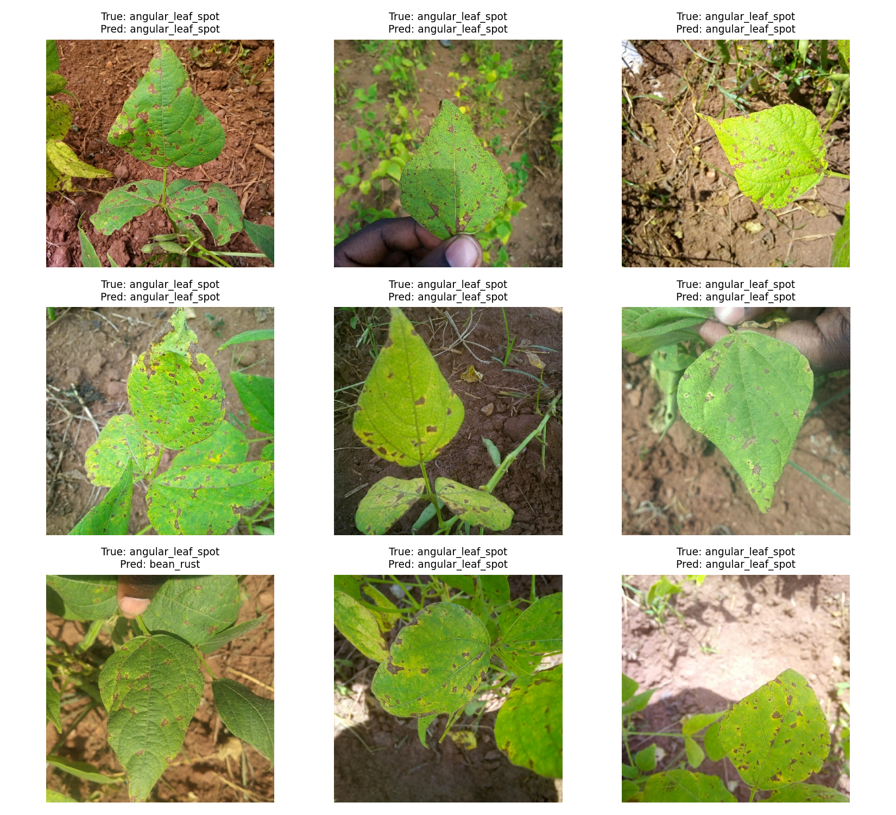

### ResNet 各類別結果

| 類別 | Precision | Recall | F1 | Support |
| --- | --- | --- | --- | --- |
| angular_leaf_spot | 0.9333 | 0.9767 | 0.9545 | 43 |
| bean_rust | 0.9756 | 0.9302 | 0.9524 | 43 |
| healthy | 1.0000 | 1.0000 | 1.0000 | 42 |
| macro avg | 0.9696 | 0.9690 | 0.9690 | 128 |
| weighted avg | 0.9694 | 0.9688 | 0.9687 | 128 |

混淆矩陣：列為真實類別，欄為預測類別。

| 真實／預測 | angular_leaf_spot | bean_rust | healthy |
| --- | --- | --- | --- |
| angular_leaf_spot | 42 | 1 | 0 |
| bean_rust | 3 | 40 | 0 |
| healthy | 0 | 0 | 42 |

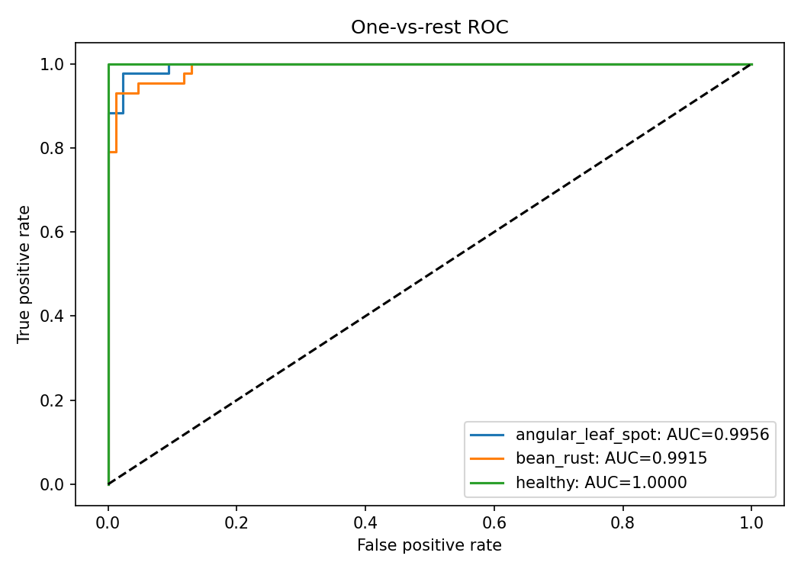

finetune：依 validation loss 最低選擇第 7 epoch；val_loss=0.116813，同一 epoch val_accuracy=0.954887。

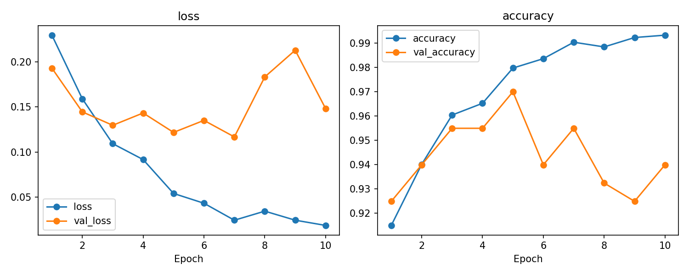

warmup：依 validation loss 最低選擇第 3 epoch；val_loss=0.247999，同一 epoch val_accuracy=0.909774。

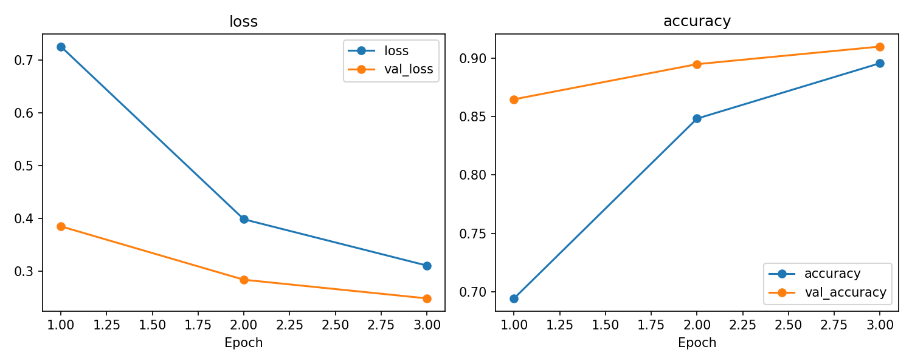

使用預訓練 backbone 並實際微調；最終採用 finetune 權重。warmup 最佳 val_loss=0.247999，finetune 最佳 val_loss=0.116813。

## Q4 

模型：ImageNet 預訓練 MobileNetV2 encoder + GRU decoder；參數量 3,287,688；實際訓練 9 epochs。完整測試 1,000 張影像，每張使用全部 5 句 reference。

BLEU 為 0–1 corpus BLEU，smoothing method1。時間為 warm batch=1；總時間包含 JPEG 讀取、resize、CNN encoder 及 decoder，兩種方法共用各影像的 encoder 計時。

| 解碼 | BLEU-1 | BLEU-2 | BLEU-3 | BLEU-4 | 平均 decoder ms | 平均總時間 ms | 中位總時間 ms |
| --- | --- | --- | --- | --- | --- | --- | --- |
| greedy | 0.5255 | 0.3477 | 0.2248 | 0.1459 | 66.1857 | 145.0706 | 140.9640 |
| beam3 | 0.5572 | 0.3722 | 0.2462 | 0.1624 | 111.5331 | 190.4179 | 187.5232 |

GRU 訓練總時間未留存（舊訓練發生 NLTK 錯誤後，以既有權重恢復評估），因此不填造數值。token accuracy 是 teacher forcing 下的逐 token 指標，不等於整句描述正確率。

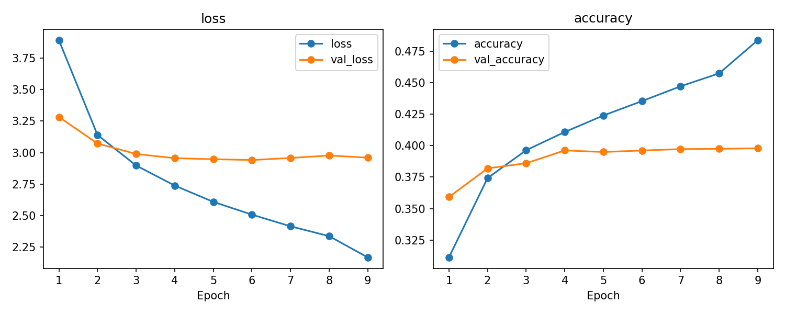

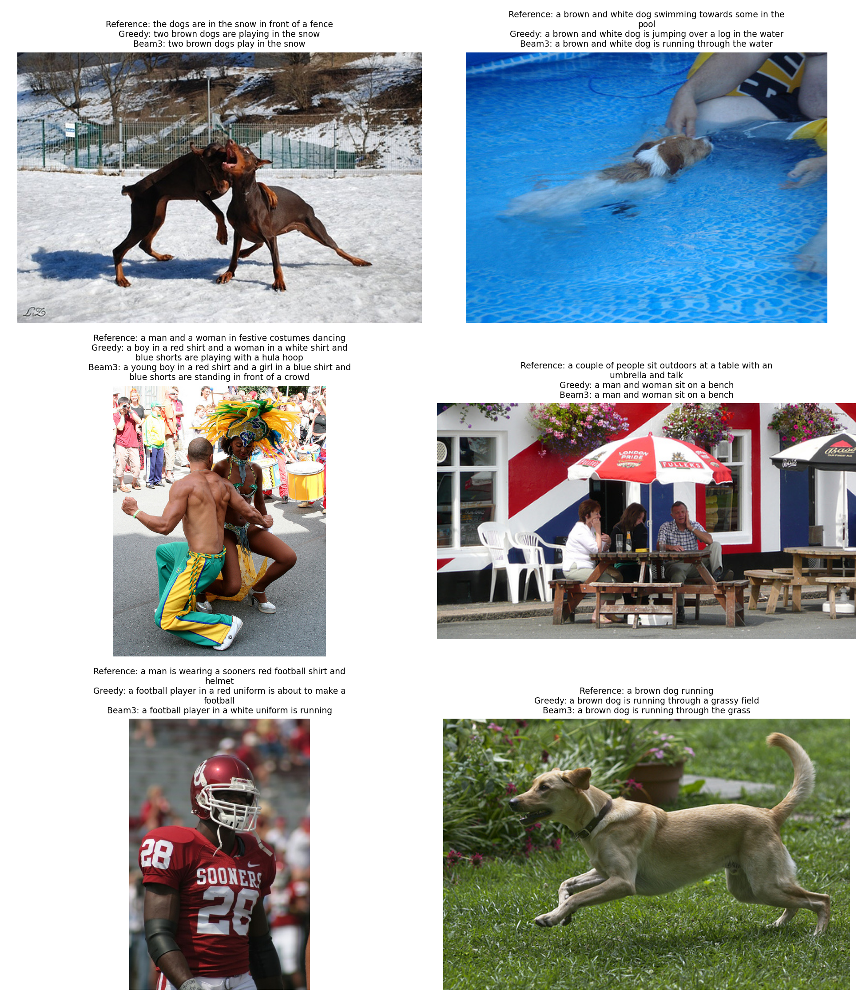

### 描述範例

- 影像：3385593926_d3e9c21170.jpg
  - Greedy：two brown dogs are playing in the snow
  - Beam3：two brown dogs play in the snow
  - References：the dogs are in the snow in front of a fence / the dogs play on the snow / two brown dogs playfully fight in the snow / two brown dogs wrestle in the snow / two dogs playing in the snow

- 影像：2677656448_6b7e7702af.jpg
  - Greedy：a brown and white dog is jumping over a log in the water
  - Beam3：a brown and white dog is running through the water
  - References：a brown and white dog swimming towards some in the pool / a dog in a swimming pool swims toward sombody we cannot see / a dog swims in a pool near a person / small dog is paddling through the water in a pool / the small brown and white dog is in the pool

- 影像：311146855_0b65fdb169.jpg
  - Greedy：a boy in a red shirt and a woman in a white shirt and blue shorts are playing with a hula hoop
  - Beam3：a young boy in a red shirt and a girl in a blue shirt and blue shorts are standing in front of a crowd
  - References：a man and a woman in festive costumes dancing / a man and a woman with feathers on her head dance / a man and a woman wearing decorative costumes and dancing in a crowd of onlookers / one performer wearing a feathered headdress dancing with another performer in the streets / two people are dancing with drums on the right and a crowd behind them

## Gemini 描述符合度

評審模型：gemini-3.5-flash-lite。同一批 10 張影像，各方法評估 10 句，共 20 筆；以排序後前 10 個共同影像。

| 解碼 | 樣本數 | 符合數 | 符合比例 | 平均分數／5 | 平均評審 API ms |
| --- | --- | --- | --- | --- | --- |
| greedy | 10 | 2 | 20.0% | 1.90 | 1808.40 |
| beam3 | 10 | 2 | 20.0% | 2.00 | 1751.15 |

Gemini API 評審時間與 caption 生成時間分開計算。judgments.json 另保存舊 Gemini 2.5 Flash 的 10 筆紀錄；正式統計只使用 summary.json 指定的 Gemini 3.5 Flash-Lite 20 筆，未混算。

### 逐張判斷

| 影像 | Greedy 符合 | Greedy 分數 | Beam3 符合 | Beam3 分數 |
| --- | --- | --- | --- | --- |
| 1056338697_4f7d7ce270.jpg | 否 | 1 | 否 | 1 |
| 106490881_5a2dd9b7bd.jpg | 否 | 1 | 否 | 1 |
| 1082379191_ec1e53f996.jpg | 否 | 1 | 否 | 1 |
| 1084040636_97d9633581.jpg | 否 | 1 | 否 | 1 |
| 1096395242_fc69f0ae5a.jpg | 否 | 2 | 否 | 2 |
| 1107246521_d16a476380.jpg | 否 | 2 | 是 | 5 |
| 1119015538_e8e796281e.jpg | 是 | 5 | 是 | 5 |
| 1122944218_8eb3607403.jpg | 否 | 1 | 否 | 2 |
| 1131800850_89c7ffd477.jpg | 是 | 4 | 否 | 1 |
| 1131932671_c8d17751b3.jpg | 否 | 1 | 否 | 1 |

### 1056338697_4f7d7ce270.jpg / greedy

生成描述：a woman in a white shirt and a woman sitting on a bench

Gemini：不符合；1/5。

原因（Gemini 原文）：The candidate caption mentions 'a woman in a white shirt and a woman sitting on a bench', which is completely incorrect. The image shows a woman with blonde hair wearing a blue top, with her arm raised in the street, and there is no woman sitting on a bench.

被指出的幻覺：white shirt；a woman sitting on a bench

### 1056338697_4f7d7ce270.jpg / beam3

生成描述：a woman in a white tank top is standing in front of a brick wall

Gemini：不符合；1/5。

原因（Gemini 原文）：The candidate caption claims the woman is in a white tank top and standing in front of a brick wall, but she is actually wearing a blue top and is standing near a street with cars, not in front of a brick wall.

被指出的幻覺：white tank top；brick wall

### 106490881_5a2dd9b7bd.jpg / greedy

生成描述：a young boy wearing a red shirt is standing in the middle of a pool

Gemini：不符合；1/5。

原因（Gemini 原文）：The candidate caption incorrectly states that the boy is wearing a red shirt and is in a pool. In the image, the boy is shirtless, wearing blue patterned swim trunks, and is at the beach/ocean shore.

被指出的幻覺：red shirt；middle of a pool

### 106490881_5a2dd9b7bd.jpg / beam3

生成描述：a young boy wearing a red shirt is standing in the middle of a pool

Gemini：不符合；1/5。

原因（Gemini 原文）：The candidate caption incorrectly states that the boy is wearing a red shirt and is standing in a pool, whereas he is shirtless, wearing swim trunks, and is at the beach/ocean shore.

被指出的幻覺：wearing a red shirt；in the middle of a pool

### 1082379191_ec1e53f996.jpg / greedy

生成描述：two children are sitting on a bench

Gemini：不符合；1/5。

原因（Gemini 原文）：The image shows an adult man and an adult woman sitting on a wooden platform (or edge), not two children sitting on a bench.

被指出的幻覺：two children；bench

### 1082379191_ec1e53f996.jpg / beam3

生成描述：two children are sitting on a wooden bench

Gemini：不符合；1/5。

原因（Gemini 原文）：The image shows two adults (a woman and a shirtless man) sitting on a wooden dock or bench, not children.

被指出的幻覺：two children

### 1084040636_97d9633581.jpg / greedy

生成描述：a white dog is running through the snow

Gemini：不符合；1/5。

原因（Gemini 原文）：The image shows a white dog resting on a tiled floor, not running through snow.

被指出的幻覺：running；through the snow

### 1084040636_97d9633581.jpg / beam3

生成描述：a white dog is running through the snow

Gemini：不符合；1/5。

原因（Gemini 原文）：The image shows a white dog resting on a tiled floor, not running through the snow.

被指出的幻覺：running through the snow

### 1096395242_fc69f0ae5a.jpg / greedy

生成描述：a young boy wearing a red shirt is playing with a ball

Gemini：不符合；2/5。

原因（Gemini 原文）：The candidate caption mentions the boy is playing with a ball, but he is actually playing with a toy/light-up gadget (like a spinning top toy or toy gun) held up to his face, not a ball.

被指出的幻覺：playing with a ball

### 1096395242_fc69f0ae5a.jpg / beam3

生成描述：a young boy wearing a red shirt is playing with a red ball

Gemini：不符合；2/5。

原因（Gemini 原文）：The caption correctly identifies the young boy wearing a red shirt, but incorrectly states he is playing with a red ball. The boy is actually playing with a toy/light-up gadget (and there is a white/multicolored soccer ball on the floor, not a red ball).

被指出的幻覺：a red ball

### 1107246521_d16a476380.jpg / greedy

生成描述：two black dogs are playing in the grass

Gemini：不符合；2/5。

原因（Gemini 原文）：The image shows only one black dog playing in the grass, not two.

被指出的幻覺：two black dogs

### 1107246521_d16a476380.jpg / beam3

生成描述：a black dog is running through the grass

Gemini：符合；5/5。

原因（Gemini 原文）：The candidate caption accurately and concisely describes the image, capturing both the subject (a black dog) and the action/setting (running through the grass).

被指出的幻覺：無

### 1119015538_e8e796281e.jpg / greedy

生成描述：a small dog is running through a grassy area

Gemini：符合；5/5。

原因（Gemini 原文）：The caption accurately describes the image showing a small dog running through a grassy area.

被指出的幻覺：無

### 1119015538_e8e796281e.jpg / beam3

生成描述：a brown dog is running through a grassy area

Gemini：符合；5/5。

原因（Gemini 原文）：The image clearly shows a brown puppy running through a grassy area, making the caption fully accurate.

被指出的幻覺：無

### 1122944218_8eb3607403.jpg / greedy

生成描述：a young boy wearing a red shirt is standing in front of a crowd

Gemini：不符合；1/5。

原因（Gemini 原文）：The candidate caption describes a 'young boy wearing a red shirt standing in front of a crowd', which is completely incorrect. The image shows a baby wearing a white shirt holding a Pakistani flag, not a boy in a red shirt in front of a crowd.

被指出的幻覺：young boy wearing a red shirt；standing in front of a crowd

### 1122944218_8eb3607403.jpg / beam3

生成描述：a little girl in a white dress is standing in front of a house

Gemini：不符合；2/5。

原因（Gemini 原文）：The image shows a baby boy (not a girl) in a white outfit holding a flag, and the location is indoors, not necessarily 'in front of a house'.

被指出的幻覺：girl；in front of a house

### 1131800850_89c7ffd477.jpg / greedy

生成描述：a brown and white dog is running through the water

Gemini：符合；4/5。

原因（Gemini 原文）：The caption correctly identifies a brown and white dog and the water context (implied by the splashing/rain/water setting), though it specifically says 'running' which is partially inferred since only the upper body is clearly in motion.

被指出的幻覺：無

### 1131800850_89c7ffd477.jpg / beam3

生成描述：two dogs are playing in the water

Gemini：不符合；1/5。

原因（Gemini 原文）：The image shows only one dog shaking off water, not two dogs playing.

被指出的幻覺：two dogs；playing in the water

### 1131932671_c8d17751b3.jpg / greedy

生成描述：a young girl in a pink shirt is sitting on a couch

Gemini：不符合；1/5。

原因（Gemini 原文）：The image depicts a young boy jumping on a bed, not a young girl in a pink shirt sitting on a couch.

被指出的幻覺：young girl；pink shirt；sitting；couch

### 1131932671_c8d17751b3.jpg / beam3

生成描述：a young girl in a pink shirt is sitting on a bed

Gemini：不符合；1/5。

原因（Gemini 原文）：The candidate caption describes a 'young girl in a pink shirt', but the image clearly shows a young boy jumping in blue and white athletic clothes.

被指出的幻覺：young girl；pink shirt；is sitting on a bed

## 實驗比較與觀察

- Q2：LSTM Accuracy 比 RNN 高 18.30 個百分點；Macro-AUC 高 0.1854。本次 LSTM 訓練較快，實際 epochs 為 4，RNN 為 6。
- Q3：ResNet Accuracy 比 ViT 高 5.47 個百分點，Macro-AUC 高 0.0063；兩者皆使用相同 128 張官方 test。
- Q4：Beam3 的 BLEU-4 比 Greedy 高 0.0166（相對 11.36%），平均總時間增加 45.35 ms（31.26%）。
- Gemini：兩種方法均僅 2/10 句符合，平均分數 1.9 與 2.0。常見問題是人物年齡、衣服顏色、數量、動作與場景錯誤；較高 BLEU 不保證影像描述完全符合。
