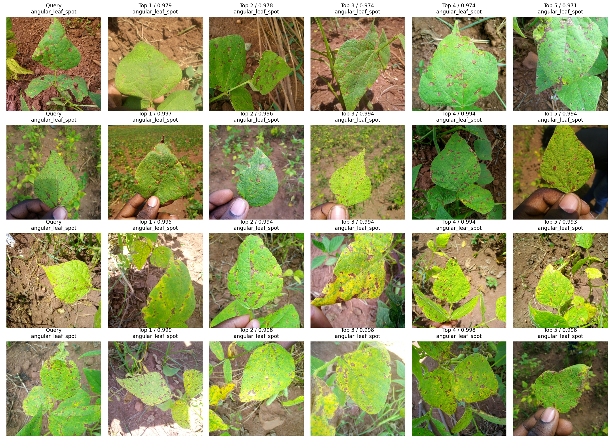
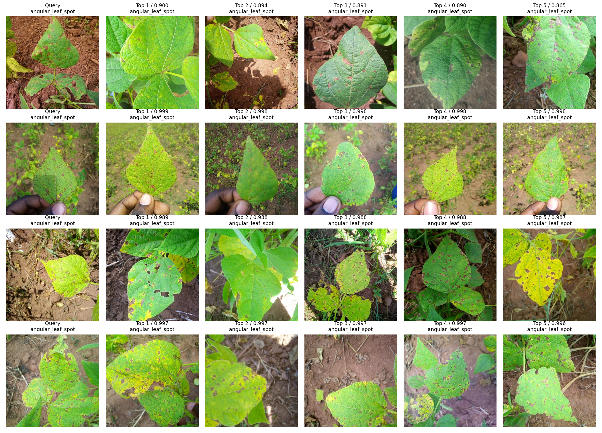
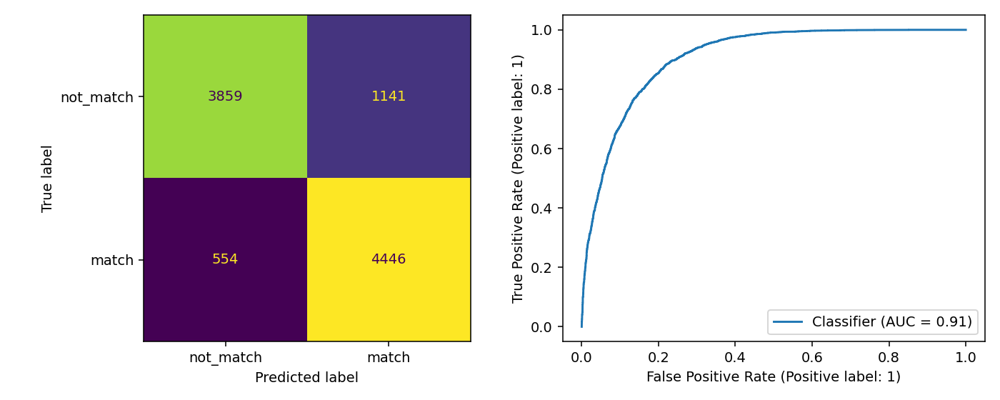
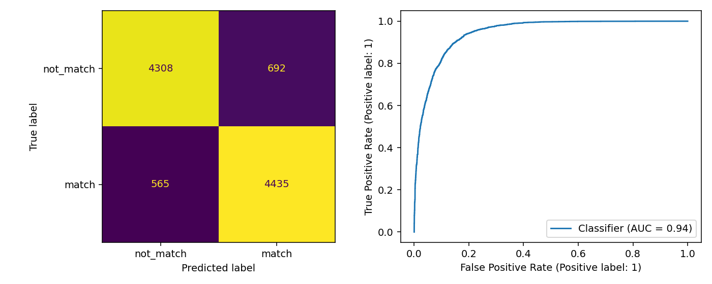
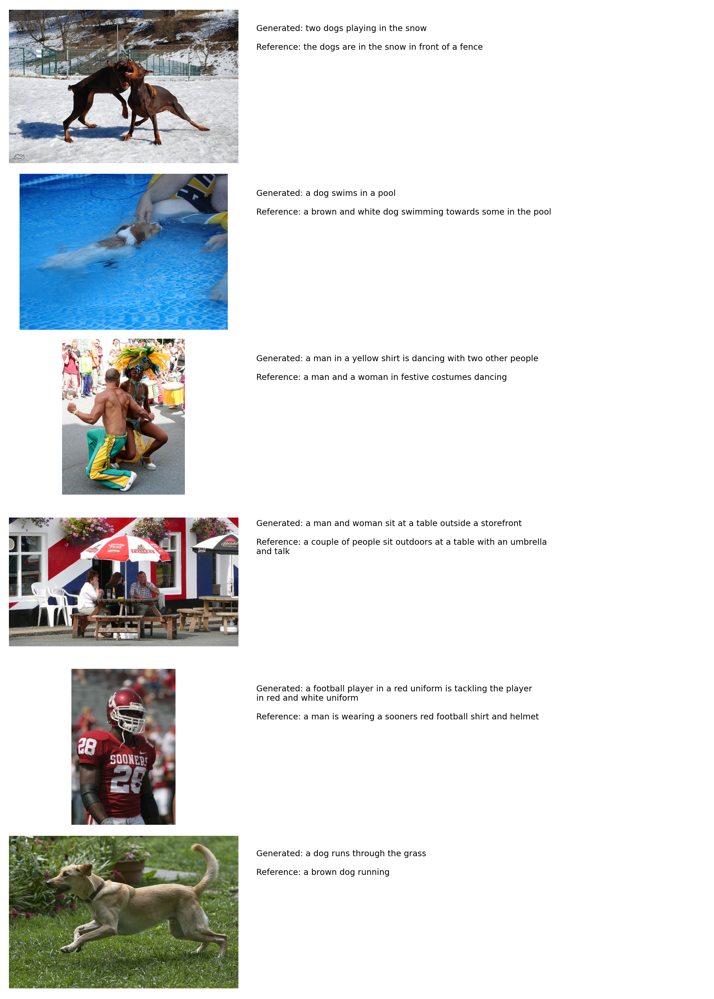

# MMIP 第五週作業
## Quiz 1：影像檢索任務
基礎：自行準備影像檢索資料集
基礎：建立並訓練影像檢索模型
基礎：完成影像檢索推論，展示結果
進階：分別使用 CNN 與 ViT Backbone
進階：比較檢索表現，整理結果
使用 Beans 葉片影像，包含角斑病、豆銹病、健康三類；train／validation／test 為 1034／133／128 張。
| 模型 | P@5 | mAP@5 | Hit@5 |
| --- | --- | --- | --- |
| ResNet18 | 0.8875 | 0.8738 | 0.9297 |
| ViT-B/16 | 0.9391 | 0.9356 | 0.9688 |
ViT 的 P@5 高 5.16 
個百分點，本次檢索表現較好。這裡以「相同疾病／健康類別」定義相關影像。

## Quiz 2：多模態深度學習神經網路
基礎：準備包含影像與文字的多模態資料集
基礎：使用影像與文字 Backbone，融合特徵建立分類模型
基礎：完成訓練與多模態分類推論
進階：更換至少一種 Backbone，重新訓練與推論
進階：比較不同 Backbone 組合，整理結果
使用 Flickr8k，每張影像有五句描述。train／validation／test 為 6000／1000／1000 張；建立配對與不配對資料，分別共 60000／10000／10000 pairs。

| 模型 | Accuracy | Macro-F1 | ROC-AUC | 測試 pairs | 訓練秒數 |
| --- | --- | --- | --- | --- | --- |
| ResNet18 + GRU | 0.8305 | 0.8299 | 0.9074 | 10000 | 85.7462 |
| ViT-B/16 + GRU | 0.8743 | 0.8743 | 0.9446 | 10000 | 86.2049 |
ViT 組合的 Accuracy 高 4.38 個百分點，測試錯誤減少 438 筆。兩組皆於第 5 epoch 提前停止，採用 validation loss 最低的第 2 epoch 權重。

## Quiz 3：CLIP Image Captioning
基礎：完成資料準備，可沿用第四週資料集
基礎：CLIP Image Encoder＋文字 Decoder
基礎：完成訓練並產生影像描述
進階：比較第四週與本次 BLEU、BERTScore
沿用 Flickr8k 及官方切分；每張五句描述，詞彙表只用 train 資料建立。

| 模型 | 解碼 | BLEU-1 | BLEU-4 | BERTScore-F1 | 共同影像 |
| --- | --- | --- | --- | --- | --- |
| week5_clip_gru | greedy | 0.6296 | 0.2066 | 0.8652 | 1000 |
| week4_mobilenetv2_gru | greedy | 0.5255 | 0.1459 | 0.8424 | 1000 |
| week4_mobilenetv2_gru | beam3 | 0.5572 | 0.1624 | 0.8454 | 1000 |
第五週 BLEU-4 相較第四週 greedy 相對提升 41.63%，相較 beam3 提升 27.18%。BERTScore 統一使用 DistilBERT 第 5 層設定。
