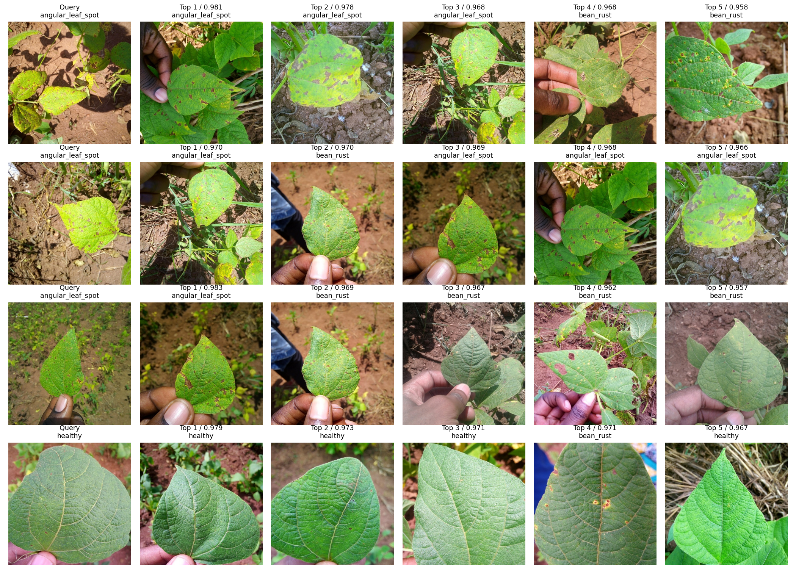
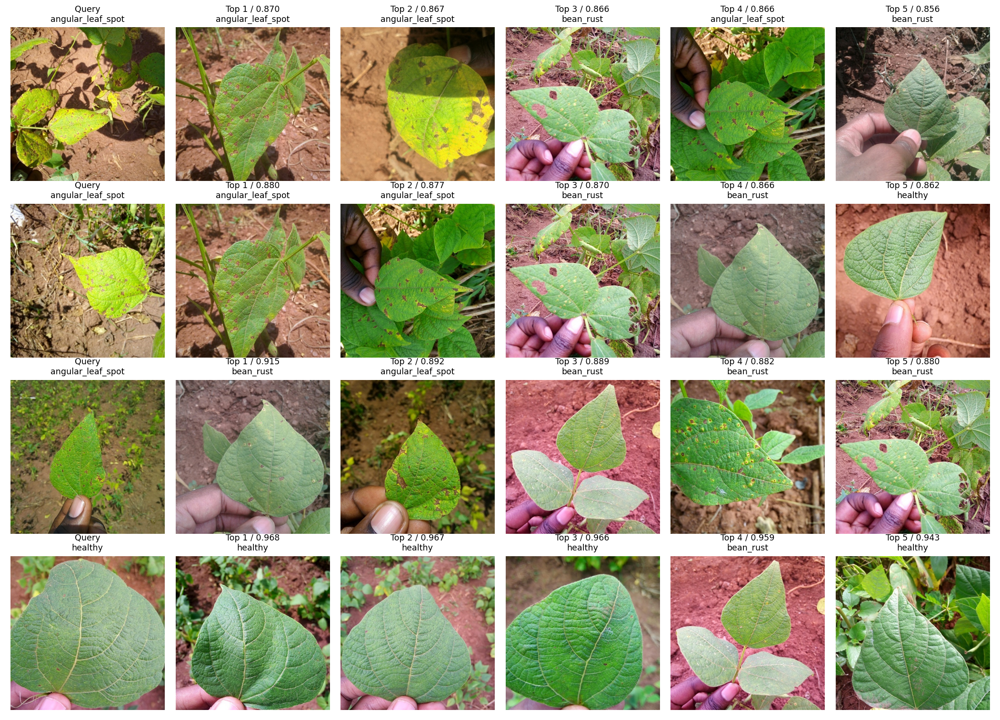
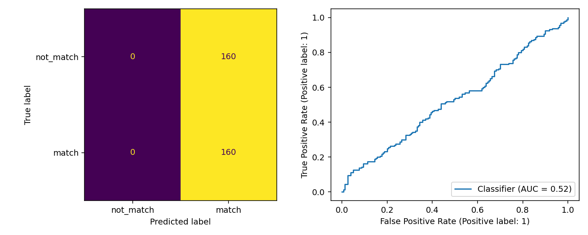
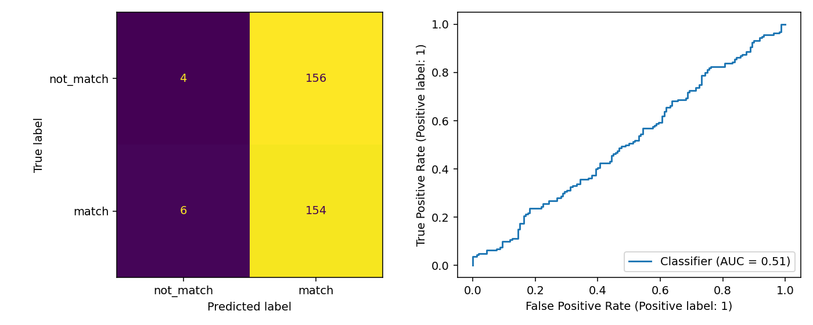
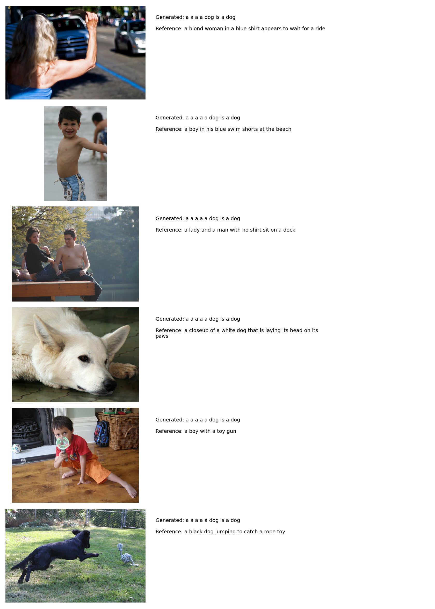
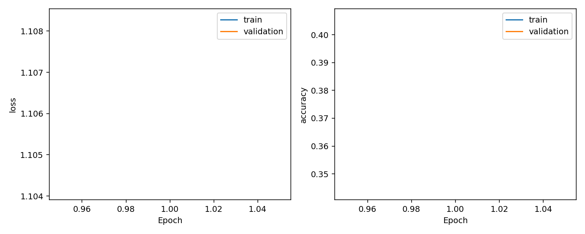
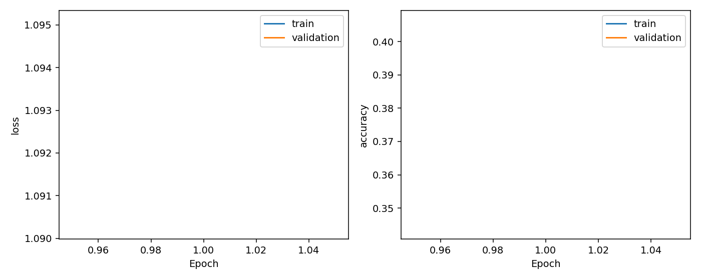
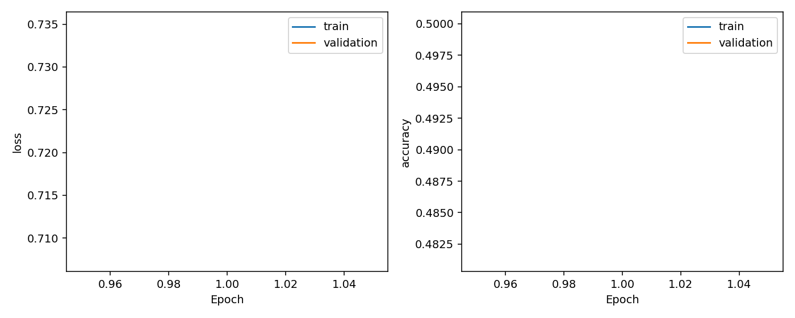
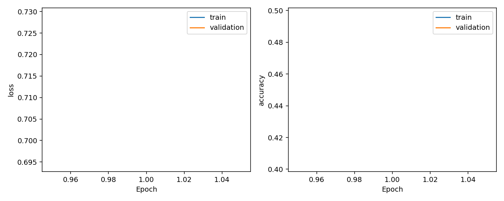
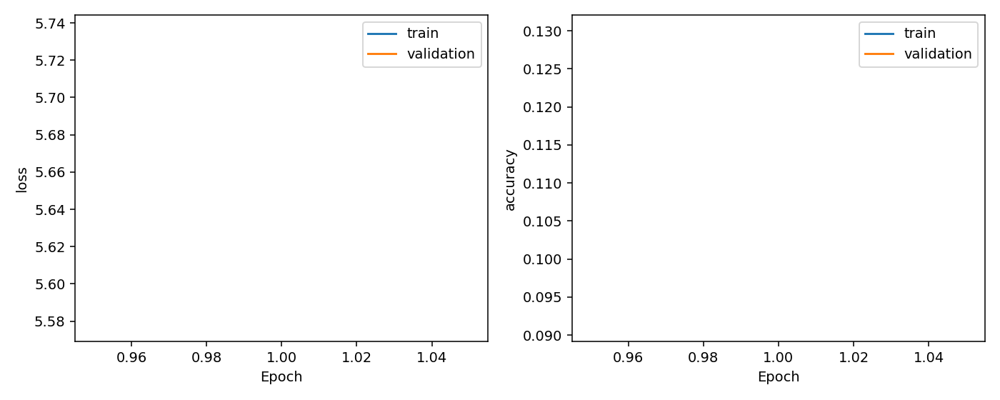

# MMIP Week 5 實驗報告

所有表格只讀取本次輸出資料夾中的實測檔案。未執行的項目不填造數值。

Beans 以同疾病／健康類別視為相關影像；train 作為 gallery、test 作為 query。
Flickr8k 沿用官方影像切分，詞彙表只在 train 建立。影像 backbone 凍結；投影層、文字 GRU、融合分類器或 decoder 有實際訓練。

- ResNet18：**除錯子集**，每 split 最多 32 張，結果不可當作完整作業成績。
- ViT-B/16：**除錯子集**，每 split 最多 32 張，結果不可當作完整作業成績。
- ResNet18 + GRU：**除錯子集**，每 split 最多 32 張，結果不可當作完整作業成績。
- ViT-B/16 + GRU：**除錯子集**，每 split 最多 32 張，結果不可當作完整作業成績。
- CLIP + GRU：**除錯子集**，每 split 最多 32 張，結果不可當作完整作業成績。

## Q1 影像檢索

| 模型 | P@k | R@k | Hit@k | mAP@k | k | 訓練秒數 |
| --- | --- | --- | --- | --- | --- | --- |
| ResNet18 | 0.5250 | 0.2591 | 0.9375 | 0.4222 | 5 | 0.2528 |
| ViT-B/16 | 0.4750 | 0.2261 | 0.9062 | 0.3826 | 5 | 0.0330 |

R@k 是找回的相關影像比例；Hit@k 是至少找到一張相關影像的 query 比例。mAP@k 分母為 min(相關總數, k)。

本次 ResNet18 的 mAP@k 較高（平手時取第一個模型）；此結果只適用於目前資料量與固定凍結 backbone 設定。

## Q2 圖文融合分類

| 模型 | Accuracy | Macro-F1 | ROC-AUC | 測試 pairs | 訓練秒數 |
| --- | --- | --- | --- | --- | --- |
| ResNet18 + GRU | 0.5000 | 0.3333 | 0.5241 | 320 | 0.5933 |
| ViT-B/16 + GRU | 0.4938 | 0.3512 | 0.5128 | 320 | 0.4584 |

負例為不同影像的描述，排除同影像與完全相同描述；仍可能偶然語意相符。這是弱標記配對實驗，不能推廣成任意圖文的語意正確率。

在相同影像切分與正負配對下，ViT-B/16 + GRU 的 Macro-F1 較高（平手時取第一個模型）。

## Q3 CLIP 影像描述

| 模型 | BLEU-1 | BLEU-2 | BLEU-3 | BLEU-4 | BERTScore-F1 | 測試影像 |
| --- | --- | --- | --- | --- | --- | --- |
| CLIP + GRU | 0.3777 | 0.1269 | 0.0415 | 0.0139 | 0.6906 | 32 |

### 與 Week 4 比較

依影像 ID 對齊 32 張，並檢查五句 references 一致；三種輸出以相同 BLEU/BERTScore 設定重新計算。

| 模型 | 解碼 | BLEU-1 | BLEU-4 | BERTScore-F1 | 共同影像 |
| --- | --- | --- | --- | --- | --- |
| week5_clip_gru | greedy | 0.3777 | 0.0139 | 0.6906 | 32 |
| week4_mobilenetv2_gru | greedy | 0.5435 | 0.1875 | 0.8455 | 32 |
| week4_mobilenetv2_gru | beam3 | 0.5341 | 0.1568 | 0.8448 | 32 |

比較包含 encoder、decoder 實作與訓練設定的差異，不能將全部提升／下降歸因於 CLIP。

### q1_cnn 學習曲線

### q1_vit 學習曲線

### q2_cnn_gru 學習曲線

### q2_vit_gru 學習曲線

### q3_clip_gru 學習曲線

## 評估設定與限制

- 模型以最低 validation loss 選取；test 不參與訓練與 early stopping。
- 訓練秒數只計可訓練模組的訓練／validation，排除下載、凍結影像特徵萃取與最終測試。
- BLEU 是 0–1 的 corpus BLEU，NLTK smoothing method1，每張使用全部五句參考。
- BERTScore 使用輸出 JSON 記錄的模型、層數與 hash；預設 DistilBERT 第 5 層、idf=False、無 baseline rescale。各模型使用同一設定，不能與其他設定的分數直接比較。
- 固定 seed 有助重現，但不同 GPU／套件版本仍可能有微小浮點差異。
